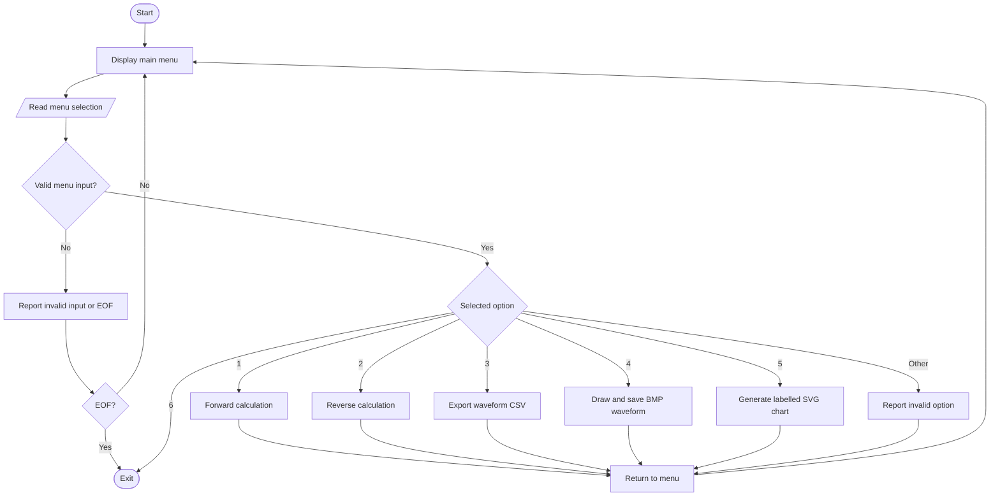
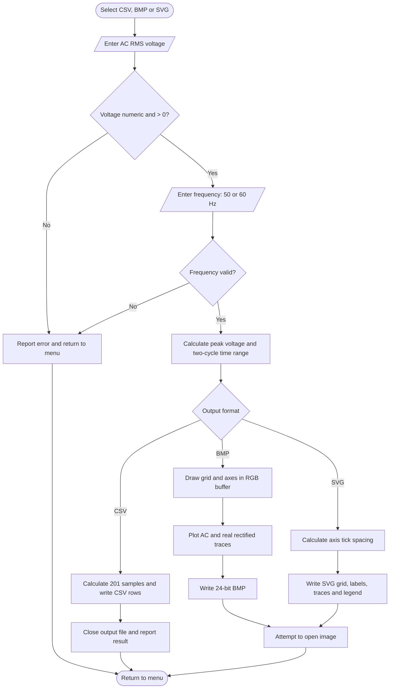

# Full-Wave Bridge Rectifier Tool

A small, menu-driven **C command-line application** for exploring the
voltage behaviour of a full-wave bridge rectifier.

The program can:

1.  Calculate an estimated DC output from an AC RMS input.
2.  Estimate the AC RMS input needed for a requested DC output.
3.  Export AC and rectified waveform samples to a CSV file.
4.  Draw and open an oscilloscope-style BMP waveform image.
5.  Generate and open a labelled SVG waveform chart.

The application is written in standard C with a few platform-specific
commands for opening the generated image in the default viewer.

------------------------------------------------------------------------

## Contents

-   [Requirements](#requirements)
-   [Project files](#project-files)
-   [Building the application](#building-the-application)
-   [Running the application](#running-the-application)
-   [Using the menu](#using-the-menu)
-   [How the code works](#how-the-code-works)
-   [Program flow chart](#program-flow-chart)
-   [Calculation methods](#calculation-methods)
-   [Generated files](#generated-files)
-   [Troubleshooting](#troubleshooting)
-   [Model limitations](#model-limitations)
-   [Cleaning the build](#cleaning-the-build)

------------------------------------------------------------------------

## Requirements

### Build requirements

-   GCC (or a compatible C compiler)
-   GNU Make
-   The C math library (`libm`), normally supplied with the system's
    compiler toolchain

On Debian or Ubuntu, the build tools can be installed with:

``` bash
sudo apt update
sudo apt install build-essential
```

On openSUSE:

``` bash
sudo zypper install gcc make
```

On Fedora:

``` bash
sudo dnf install gcc make
```

### Runtime requirements

The executable runs in a terminal. To open generated charts
automatically, the system also needs an image/document viewer and the
relevant desktop-opening command:

-   Linux: `xdg-open`
-   macOS: `open`
-   Windows: `start` (provided by the Windows command interpreter)

The program can still generate the output files if automatic opening is
unavailable.

------------------------------------------------------------------------

## Project files

The supplied project consists of these two files:

  -----------------------------------------------------------------------
  File                                Purpose
  ----------------------------------- -----------------------------------
  `fullwaverectifier.c`               Main C source: menu, calculations,
                                      waveform generation, BMP and SVG
                                      output

  `Makefile`                          Build, run and clean targets
  -----------------------------------------------------------------------

The Makefile defines:

``` make
CC = gcc
CFLAGS = -Wall -Wextra -O2
LDFLAGS = -lm
TARGET = FullWaverectifier
SRC = fullwaverectifier.c
```

The resulting executable is named `FullWaverectifier`.

Keep the C source and Makefile in the same directory.

------------------------------------------------------------------------

## Building the application

Open a terminal and change to the directory containing
`fullwaverectifier.c` and `Makefile`.

Build with:

``` bash
make
```

The Makefile compiles the source using:

``` bash
gcc -Wall -Wextra -O2 fullwaverectifier.c -o FullWaverectifier -lm
```

The options mean:

-   `-Wall -Wextra`: enable common compiler warnings.
-   `-O2`: enable compiler optimisation.
-   `-lm`: link the mathematical library used by functions such as
    `sqrt()`, `sin()`, `fabs()`, `pow()` and `floor()`.

If compilation succeeds, the executable `FullWaverectifier` will be
created in the project directory.

### Build and run in one command

The Makefile also provides a `run` target:

``` bash
make run
```

This builds the executable if necessary and then starts it.

------------------------------------------------------------------------

## Running the application

You can start the program using either:

``` bash
make run
```

or, after building:

``` bash
./FullWaverectifier
```

On Windows, run the generated executable from Command Prompt:

``` bat
FullWaverectifier.exe
```

The program displays a numbered menu:

``` text
==========================================
   FULL-WAVE BRIDGE RECTIFIER TOOL (C)
==========================================
  1. Forward: AC RMS -> DC Output
  2. Reverse: Target DC -> AC RMS
  3. Export Waveform CSV (50/60 Hz)
  4. Plot & Open Waveform Image (BMP)
  5. Auto Plot Labelled Chart (SVG)
  6. Exit
Select an option (1-6):
```

Enter a menu number and follow the prompts. The menu is displayed again
after each operation, so several calculations or exports can be
performed during one run.

### Input rules

-   Voltage inputs must be numeric values greater than zero.
-   Waveform export and plotting accept a frequency of **50 Hz or 60
    Hz**.
-   Invalid input is reported and the program returns to the menu.
-   Select option `6` to exit.

------------------------------------------------------------------------

## Using the menu

### 1. Forward calculation: AC RMS to DC

Choose option `1` and enter the AC input voltage in RMS volts.

The program reports:

-   AC peak voltage.
-   Ideal average full-wave rectified DC voltage.
-   Estimated real average rectified DC voltage without a smoothing
    capacitor.
-   Approximate smoothed DC voltage with a capacitor.

The calculation uses a fixed total bridge diode drop of 1.4 V.

### 2. Reverse calculation: target DC to AC RMS

Choose option `2` and enter the required DC output voltage.

The program reports three estimates for the transformer secondary RMS
voltage:

-   Ideal bridge, without a capacitor.
-   Real bridge, without a capacitor.
-   Real bridge, with a smoothing capacitor.

These values are calculated estimates using the formulae described
below; they are not a transformer or power-supply design guarantee.

### 3. Export waveform data to CSV

Choose option `3`, enter the AC RMS voltage, and then enter `50` or `60`
for the mains frequency.

The program creates:

``` text
waveform.csv
```

The CSV contains 201 rows of sampled data (including the initial sample)
over two complete AC cycles. Its columns are:

  -----------------------------------------------------------------------
  Column                              Meaning
  ----------------------------------- -----------------------------------
  `Time (ms)`                         Sample time in milliseconds

  `AC Input (V)`                      Original signed AC sine wave

  `Ideal Rectified DC (V)`            Absolute value of the AC waveform

  `Real Rectified DC (V)`             Rectified waveform after the fixed
                                      1.4 V drop
  -----------------------------------------------------------------------

The file can be opened in a spreadsheet application or imported into a
plotting/data-analysis program.

### 4. Plot and open waveform image (BMP)

Choose option `4`, enter the AC RMS voltage, and select `50` or `60` Hz.

The program creates:

``` text
waveform.bmp
```

The BMP is an 800 × 500 pixel image with a dark oscilloscope-style
background, grid and zero-voltage axis.

-   **Cyan:** AC input sine wave.
-   **Green:** real rectified output after the assumed diode drop.

The program then asks the operating system to open the image using its
default viewer.

### 5. Automatically generate a labelled SVG chart

Choose option `5`, enter the AC RMS voltage, and select `50` or `60` Hz.

The program creates:

``` text
waveform.svg
```

The SVG chart includes:

-   A title showing the entered RMS voltage and frequency.
-   Horizontal voltage grid lines and voltage labels.
-   Vertical time grid lines and time labels.
-   A plot border and labelled axes.
-   A legend for all three waveforms.

The plotted traces are:

-   **Blue:** AC input.
-   **Grey dashed:** ideal rectified waveform.
-   **Green:** real rectified waveform after the assumed 1.4 V drop.

SVG is a scalable vector format, so the chart can be enlarged without
the pixelation associated with a bitmap image. The program attempts to
open it automatically.

### 6. Exit

Choose option `6` to leave the application.

------------------------------------------------------------------------

## How the code works

The source is organised as a set of functions, with `main()` controlling
the menu and dispatching each requested operation.

### 1. Headers, constants and image buffer

The program includes standard input/output, general utilities,
fixed-width integer types and mathematical functions.

It defines:

-   An 800 × 500 RGB image buffer for BMP drawing.
-   A 1.4 V assumed total bridge diode drop.
-   ANSI terminal colour sequences for menu and result presentation.
-   SVG chart dimensions and margins.

The image buffer is a static three-dimensional byte array:

``` c
static uint8_t img[HEIGHT][WIDTH][3];
```

Each pixel stores red, green and blue channel values.

### 2. Input handling

`clear_buffer()` discards the remainder of the current input line after
invalid input. It also stops safely at end-of-file.

The menu and calculation functions use `scanf()` to read numeric input
and check whether conversion succeeded. Invalid or out-of-range values
are rejected rather than used in a calculation.

### 3. Forward and reverse calculations

`forward_calc()` converts an AC RMS input into peak voltage and
estimated DC values.

`reverse_calc()` works in the opposite direction: it starts with a
target DC voltage and estimates the required AC RMS voltage using the
program's ideal and diode-drop-adjusted formulae.

Both functions return to the menu when their work is complete.

### 4. CSV waveform generation

`export_csv()`:

1.  Reads the RMS voltage and mains frequency.
2.  Opens `waveform.csv` for writing.
3.  Calculates the peak voltage.
4.  Sets the sample interval to cover two full cycles.
5.  Calculates the AC, ideal rectified and real rectified voltage at
    each sample.
6.  Writes the values as comma-separated columns.
7.  Closes the file and reports success.

The sample count is 200 intervals, giving 201 output samples because the
loop includes both endpoints.

### 5. BMP waveform drawing

`plot_and_open_image()` prepares the RGB buffer and draws the waveform.

It uses the helper functions:

-   `set_pixel()` writes a pixel if its coordinates are inside the
    image.
-   `draw_thick_line()` uses an integer line-rasterisation method to
    join successive waveform points. Each point is drawn as a small 2 ×
    2 block for visibility.
-   `save_bmp()` writes a 24-bit BMP file, including its file header,
    BGR pixel data and row padding.
-   `open_image_file()` invokes the operating system's default
    image-opening command.

The plotting loop maps time to the horizontal pixel coordinate and
voltage to the vertical coordinate. It draws the AC input in cyan and
the real rectified output in green.

### 6. SVG chart generation

The SVG chart uses a separate plotting path and does not depend on the
BMP pixel buffer.

The helper functions are:

-   `nice_step()`: selects a readable axis interval using a 1, 2 or 5 ×
    10ⁿ step.
-   `wave_value()`: returns the voltage for the requested waveform mode
    (AC, ideal rectified or real rectified).
-   `svg_polyline()`: writes a sampled waveform as an SVG polyline.

`plot_svg_chart()` reads the inputs, calculates suitable axis scales,
writes the SVG background, grid, labels, border, traces and legend,
closes the file and attempts to open it.

### 7. Main menu

`main()` contains the application loop.

It prints the menu, reads the user's selection and calls the matching
function. The loop continues until the user chooses option `6` or
standard input reaches end-of-file.

------------------------------------------------------------------------

## Program flow chart

The following flow chart shows the overall program control flow. It can
be viewed in Markdown applications that support Mermaid diagrams.



### Waveform export and plotting flow

The CSV, BMP and SVG options each follow a similar input and calculation
sequence, but produce different output formats.



------------------------------------------------------------------------

## Calculation Methods

The following equations describe the calculations implemented in the supplied C source:

### AC RMS to Peak Voltage
For a sinusoidal AC input:
V_peak = V_RMS × √2

### Ideal Full-Wave Rectified Average
For an ideal full-wave rectified sine wave:
V_DC (ideal) = (2 × V_peak) / π

### Real Bridge Estimate (Without a Smoothing Capacitor)
The source assumes a total conducting-path diode drop of:
V_D = 1.4 V

### It calculates:
V_peak (real) = max(V_peak - 1.4, 0)
V_DC (real) = (2 × V_peak (real)) / π

### Smoothed Output Estimate
For the forward calculation, the program reports:
V_DC (smoothed) ≈ V_peak (real)

Note: This is a simple peak-voltage estimate. It does not calculate capacitor ripple or load-dependent voltage drop.

### Reverse Calculation

### For a requested DC voltage, the source calculates:
V_peak (needed) = (V_DC (target) × π) / 2
V_RMS (ideal) = V_peak (needed) / √2
V_RMS (real, no cap) = (V_peak (needed) + 1.4) / √2

### For the capacitor estimate, the source uses:
V_RMS (real, cap) = (V_DC (target) + 1.4) / √2

(Note: The last expression is the program's implemented estimate and should not be treated as a complete power-supply design equation.)


------------------------------------------------------------------------

## Generated files

The application writes output files into its **current working
directory** (normally the directory from which it was launched).

  -----------------------------------------------------------------------
  File                    Created by              Description
  ----------------------- ----------------------- -----------------------
  `waveform.csv`          Menu option 3           Sampled AC and
                                                  rectified waveform data

  `waveform.bmp`          Menu option 4           800 × 500 bitmap
                                                  waveform plot

  `waveform.svg`          Menu option 5           Labelled scalable
                                                  waveform chart
  -----------------------------------------------------------------------

Running an export again overwrites the corresponding file with the new
result.

The supplied `clean` target removes the executable, `waveform.csv` and
`waveform.bmp`. It does **not** remove `waveform.svg`.

------------------------------------------------------------------------

## Troubleshooting

### `make: command not found`

Install GNU Make using your distribution's package manager.

### `gcc: command not found`

Install GCC or the distribution's C development toolchain.

### The program builds but an image does not open

Check that a suitable viewer is installed and that the desktop-opening
command is available. On Linux, check `xdg-open`.

The image file may still have been created in the current working
directory. Try opening it manually.

### `waveform.csv` or an image cannot be created

Check that you have write permission in the directory from which you
launched the application. Also check that the filesystem is not full.

### The program keeps returning to the menu

This is normal after a completed operation. Choose another menu option
or enter `6` to exit.

------------------------------------------------------------------------

## Model limitations

This is an educational calculator and waveform visualiser, not a
detailed circuit simulator.

The supplied source uses a fixed 1.4 V bridge diode drop and idealised
sine-wave calculations. It does not model:

-   Transformer regulation or winding resistance.
-   Diode-specific forward-voltage curves or temperature effects.
-   Load current or load resistance.
-   Smoothing capacitor value, ESR or ripple voltage.
-   Transformer losses, wiring losses or source impedance.
-   Startup surge current or component ratings.

The capacitor output is represented by a simple peak estimate. Real
power-supply output depends on the circuit, load, mains conditions and
component characteristics.

**Do not use these estimates alone to select transformer, diode,
capacitor, fuse or insulation ratings for a mains-powered circuit.** Use
appropriate engineering calculations and observe electrical safety
practices.

------------------------------------------------------------------------

## Cleaning the build

To remove the executable and the CSV/BMP output files listed in the
Makefile, run:

``` bash
make clean
```

The command is equivalent to:

``` bash
rm -f FullWaverectifier FullWaverectifier.exe waveform.csv waveform.bmp
```

It leaves the source code, Makefile and `waveform.svg` untouched.

------------------------------------------------------------------------

## Quick start

For convenience, the complete build-and-run sequence is:

``` bash
# Change to the directory containing the source and Makefile
cd /path/to/full-wave-rectifier

# Compile
make

# Run
./FullWaverectifier
```

Or simply:

``` bash
make run
```

